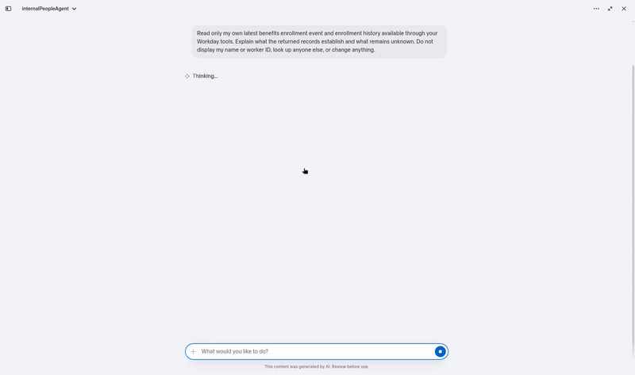
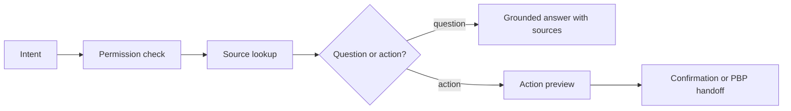

# Internal People Agent · Workday MCP

Cited answers about your own benefits, equity and HR policy, with every request recorded in an auditable decision chain.

## Demo

[](https://vimeo.com/1245051339)

[Watch on Vimeo](https://vimeo.com/1245051339). Real footage from a Workday developer sandbox: two read-only prompts against the signed-in user's own benefits records, a grounded answer with sources and unknowns, then a People Business Partner handoff draft that is never sent.

## About

Internal People Agent is a task-shaped Workday MCP server (stdio) and Claude skill. It is for employees who want answers about their own HR data, and for the People and IT teams who run it. It sits in front of a Workday MCP server you already run.

- Answers questions about your own benefits, equity and HR policy, with citations.
- Checks team transfer eligibility and starts the transfer request through the Workday approval process after you confirm.
- Hands off to your People Business Partner (PBP) with minimal, consented data.
- Records each request as an auditable decision chain.
- Runs in fixture mode with invented data, so you can try it without any accounts.

Related: [Performance Review Cycle Helper](https://github.com/peopletechflow/performance-review-cycle-helper) applies the same design to review cycles, and [workday-mcp-schema](https://github.com/peopletechflow/workday-mcp-schema) is the shared baseline both adapt their security patterns from.

## Main Logic



`start_decision_chain` records each request as `identity_scope` -> `intent` -> `permitted_retrieval` -> `grounding` -> `answer_or_preview` -> `confirmation_or_escalation`. Each step has a status, a short reason and evidence refs. It records decisions and evidence, not model reasoning.

- **Intent.** Claude classifies intent by default. TypeSafe Jev is optional (`DECISION_CLASSIFIER=jev`). Jev only answers typed questions, and Claude still drafts every answer. Low confidence, disagreement or an API error stops the chain and asks the user. Classifier output never grants permissions, so both paths run under the same permissions.
- **Sources.** Live mode calls your upstream Workday MCP server through an allowlisted capability mapping. It does not call Workday REST or SOAP itself. `list_hr_adapters` shows which capabilities are available and why not.
- **Actions.** Writes use a bound, single-use preview and commit only after confirmation, with an idempotency key. Transfers start a business process and never complete one. Unknown outcomes are never retried automatically; `reconcile_*` checks them.

Status, capability tables and the write lifecycle: [docs/ARCHITECTURE.md](docs/ARCHITECTURE.md).

### Security

- **Self-scoped reads.** The caller is the worker the upstream server reports for the user's own token. No tool accepts user, tenant or worker ids.
- **Gated live adapters.** Each capability stays off until it is mapped to one verified upstream tool. Responses are schema-validated.
- **Workday security groups.** Workday domain security decides what the agent can reach. Choose the agent's security groups and configure the security policies for its skills in Workday.
- **Consent.** The PBP handoff sends only fields you list. Benefit and equity fields need explicit consent, and nothing is sent before you confirm.

Full model: [docs/SECURITY.md](docs/SECURITY.md) and [docs/AGENT_GATEWAY_SECURITY.md](docs/AGENT_GATEWAY_SECURITY.md). Report vulnerabilities privately: [SECURITY.md](SECURITY.md).

## Deployment and Install

**Prerequisites:** Node.js 22 or later and pnpm 10. Live mode also needs Postgres and access to an upstream Workday MCP server with your own token.

**Fixture mode** (example data, embedded Postgres, no accounts):

```bash
pnpm install
pnpm check                      # typecheck and tests
FIXTURE_USER=emp_ava pnpm dev   # stdio MCP server
```

For Claude Desktop, run `pnpm build`, use `examples/claude_desktop_config.json` and load `skills/internal-people-agent/SKILL.md`.

**Live mode (direct mapping):**

1. Set `DATABASE_URL`. Migrations in `db/migrations` run at startup.
2. Save your own upstream token to a file with `chmod 600`. Set `WORKDAY_MCP_URL` and `WORKDAY_MCP_TOKEN_FILE`.
3. Copy `examples/workday-mcp-mapping.example.json`, map each capability to a real upstream tool after checking its schema and output, and set `WORKDAY_MCP_MAPPING_PATH`.
4. Copy `examples/role-map.example.json` and set `ROLE_MAP_PATH`.
5. Run `MODE=live pnpm start`. Startup fails if `identity` is not mapped. Other unmapped capabilities are gated one by one.
6. Optional Jev: `DECISION_CLASSIFIER=jev` and `TYPESAFE_API_KEY_FILE` (a `chmod 600` file). Only the question text is sent to TypeSafe.

Direct mapping mode is for MCP servers you run yourself, outside production only.

**Workday Agent Gateway mode** (the documented Workday path): a Workday operator registers the agent in ASOR, enables its skills, chooses its security groups and activates it. Then run `pnpm asu:login`, `pnpm agent-tools:snapshot`, review and set `AGENT_TOOL_POLICY_PATH`, and run `MODE=live pnpm start`. Steps, env vars and behaviour: [docs/AGENT_GATEWAY_SECURITY.md](docs/AGENT_GATEWAY_SECURITY.md#running-in-agent-gateway-mode).

**Workday native skill:** [native/](native/README.md) holds the Workday native agent instructions (App Builder). This server does not load them, and storing them here does not deploy them.

**CI:** a workflow template is in `docs/ci-workflow.example.yml`. Move it to `.github/workflows/ci.yml` from an account with the `workflow` permission.

More: [HANDOVER](HANDOVER.md), [CHANGELOG](CHANGELOG.md), [AGENTS](AGENTS.md). Contributing: see [CONTRIBUTING.md](CONTRIBUTING.md).

## License

MIT. See [LICENSE](LICENSE).

This software is provided as is, without warranty of any kind. The maintainers and PeopleTech Flow B.V. accept no responsibility or liability for any use, data, HR decisions or outcomes. You are responsible for your own tenant, security and compliance, including your Workday agreements and applicable law.

Independent project, not affiliated with or endorsed by Workday, Inc. Workday is a trademark of Workday, Inc. Verified live in a Workday developer sandbox (read-only prompts against the signed-in user's own benefits records), not yet in a production tenant. Fixture data is invented.
